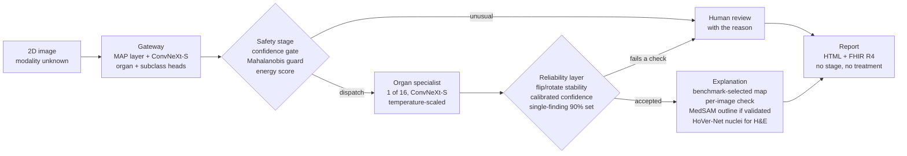
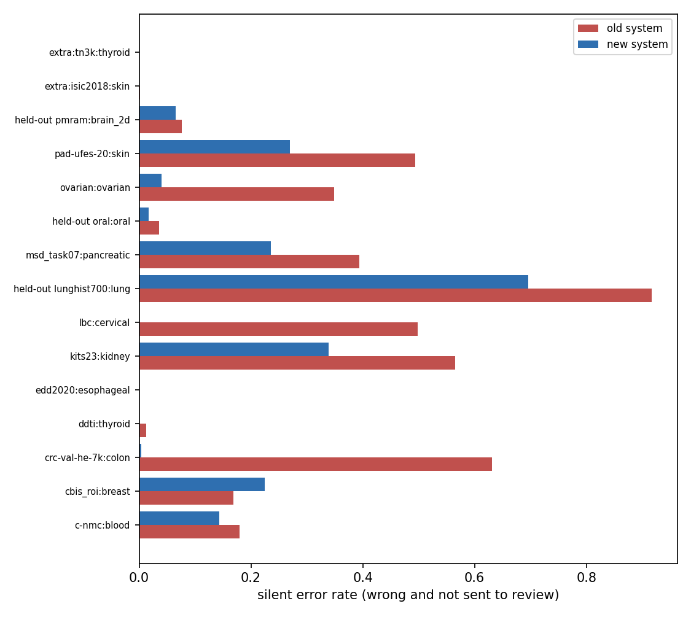
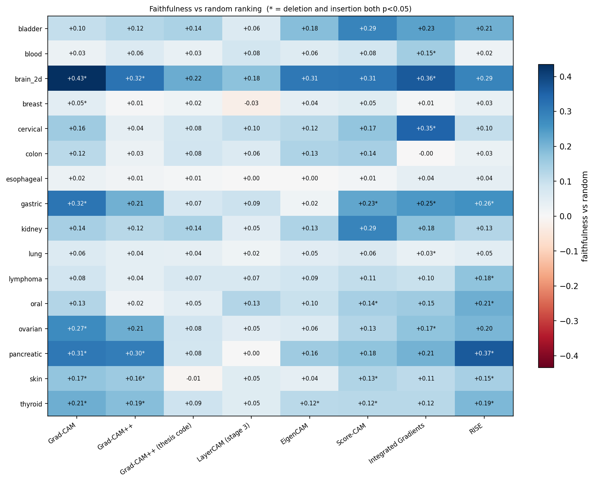
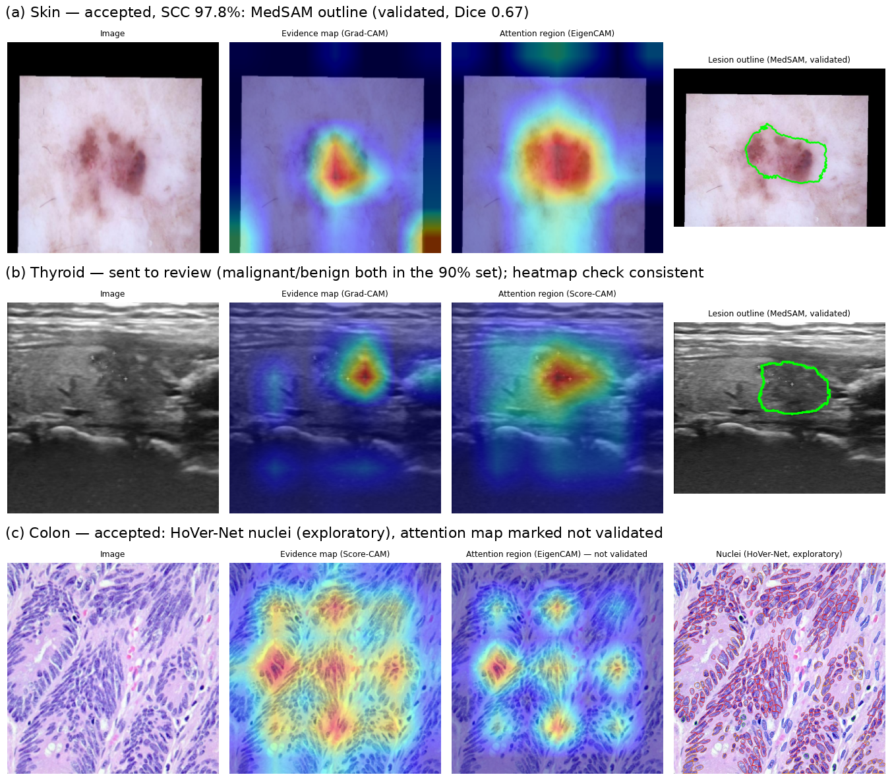

# MMAF-CD — Multi-Modal AI Framework for Enhanced Cancer Detection

**One router, 16 organs, nine imaging modalities — built, audited, and rebuilt so that every number can be trusted.**

MMAF-CD takes a 2D cancer image whose organ and modality are unknown, decides which organ it shows, sends it to one of 16 organ-specific specialist models, checks whether the answer can be trusted, explains it with a validated heat map, and writes a clinical report in HTML and HL7 FHIR R4.

The project started as my Bachelor thesis at the German University in Cairo (GUC). After submission, I re-tested every claim on new data and against simple references. The tests showed that several headline results were wrong, so the system was rebuilt around what they found. This repository contains the notebooks for both phases and the results of the final system.

> ⚠️ **Research prototype — not a medical device.** Trained and tested only on public datasets. Not approved for clinical use.

---

## Contents

- [Key results](#key-results)
- [How the system works](#how-the-system-works)
- [What I did, what failed, and how it was fixed](#what-i-did-what-failed-and-how-it-was-fixed)
- [Repository structure](#repository-structure)
- [How to run](#how-to-run)
- [Results in detail](#results-in-detail)
- [Limitations](#limitations)
- [Citation and acknowledgements](#citation-and-acknowledgements)

---

## Key results

| What | Original system | Final system |
|---|---|---|
| Routing on new patients of sources seen in training | 0–96% | **99–100%** |
| Silent errors (wrong *and* not flagged) on 14 external test sets | up to 63% (colon), 92% (lung) | **fell on 10 of 14 sets** (colon 63.1% → 0.4%, cervical 49.8% → 0%) |
| Specialists on new patients of their sources (balanced accuracy) | 0.24–0.79 | **+7 to +61 points** (e.g. cervical 0.39 → 1.00, blood 0.35 → 0.85) |
| Healthy pancreas recognised (NIH CT, held out) | 0% | **49.2%** (AUC 0.858 on MSD crops) |
| Silent errors after the reliability layer (2,866 test images) | 11.4% without rejection | **4.1%** at 25.6% review |
| Explanations | untested; one formula wrong | 8 methods benchmarked; Grad-CAM faithful on both tests for 7/16 organs |
| Nuclear segmentation, MoNuSeg (unseen) | PQ 0.281 (own model) | **PQ 0.372** (pretrained HoVer-Net) |
| Clinical text | assigned stages and treatments | next step + staging system only; **32/32 reports valid FHIR R4** |

**Still unsolved (stated, not hidden):** lung tissue from a new laboratory (LungHist700) is never routed to the lung specialist, and 69.6% of those images end as silent errors. Organs with a single labelled source do not generalise to new hospitals.

---

## How the system works



| Organ | Modality | Classes |
|---|---|---|
| Blood | blood smear / single cells | benign, early pre-B, pre-B, pro-B ALL |
| Lymphoma | H&E | CLL, FL, MCL |
| Skin | dermoscopy / photographs | 7 lesion types |
| Cervical | Pap cytology | 5 cell types |
| Gastric | H&E tiles | 8 tissue types |
| Ovarian | H&E | 5 subtypes |
| Breast | mammography | benign / malignant |
| Colon, lung, oral | H&E | 2 each |
| Brain | MRI | glioma / meningioma / tumour |
| Kidney, pancreas | CT | normal / tumour |
| Esophagus | endoscopy | benign / malignant |
| Thyroid | ultrasound | benign / malignant |
| Bladder | MRI | muscle-invasive / non-muscle-invasive |

---

## What I did, what failed, and how it was fixed

### 1. Built the system
A hierarchical gateway (ConvNeXt-Small with a modality-adaptive preprocessing layer and organ/subclass heads), a confidence-gated router, 16 specialists with FiLM conditioning, a seven-method XAI engine, HoVer-Net nuclei, conformal prediction and FHIR output. Internal results looked excellent (98.44% routing reported).

### 2. Audited it — four silent failures
| Severity | Problem found | Effect |
|---|---|---|
| 🔴 Critical | An H&E **stain normaliser was applied to every test image**, including MRI, CT and mammograms | −7.7 macro-F1 and −12.7 routing points; the reported lymphoma "collapse" (0.97 → 0.57) was this bug |
| 🔴 Critical | **Leakage**: image-level splits of a re-uploaded, augmented dataset | 55–78% of test images in six organs had a near-copy in training; pancreas had ~33 CT volumes labelled per patient |
| 🔴 Critical | **FiLM copied its hint**: the gateway's own head alone matched the FiLM specialist | bladder "gain" 0.41 → 0.95 was the gateway's, not the specialist's |
| 🔴 Critical | **Routing learned datasets, not organs** (one source per organ) | 99.2% internally, but 0–3% on new colon, lung and blood datasets |

The audit also found a wrong Grad-CAM++ formula, an explanation-agreement metric that selected on its own outcome, a trust score that detected errors no better than confidence alone, CAM "lesion masks" with Dice 0.06–0.22, and clinical text that assigned cancer stages from image classes.

### 3. Rebuilt it
- **Data:** 287,348 images from the internal collection + 16 external datasets, split by **near-duplicate group or patient** (rotation/flip-invariant perceptual hash, deterministic md5 split); three hospitals held out entirely; a **set-valued loss** lets coarse external labels train fine-grained classes.
- **Gateway and specialists:** retrained on several sources per organ with balanced sampling, stain/compression augmentation, and (for the gateway) a source-adversarial head. FiLM was replaced by validated late fusion.
- **Pancreas:** rebuilt from MSD Task07 slices with slice-level labels, cropped around the pancreas (AUC 0.64 → 0.858).
- **Safety guard:** Mahalanobis distance to 27 (organ, source) clusters + energy score.
- **Explanation benchmark:** 8 methods tested for faithfulness (deletion/insertion vs random), sanity (model randomisation) and localisation.
- **Reliability layer:** flip/rotate stability + calibrated confidence + 90% conformal sets, all fitted on validation data.
- **Reports:** curated table of 53 findings (confirmatory next step + staging system, never a stage or treatment); MedSAM outlines only where validated (skin, thyroid); pretrained HoVer-Net for nuclei; FHIR R4 validated.

All 47 problems met during the project, with severity and fix, are listed in [`docs/PROBLEM_LOG.md`](docs/PROBLEM_LOG.md).

---

## Repository structure

```
MMAF-CD/
├── notebooks/
│   ├── 00_data/            external data importer, MSD pancreas slices, pancreas-centred crops
│   ├── 01_audit/           audit of the original system (preprocessing, leakage, external validation, baselines)
│   ├── 02_rebuild/         multi-source gateway, 16 specialists, pancreatic specialist
│   ├── 03_evaluation/      end-to-end + safety guard, explanation benchmark, pretrained HoVer-Net
│   ├── 04_reporting/       reliability layer, explanations, clinical reports (HTML + FHIR)
│   └── archive/            earlier single-notebook versions and superseded stages
├── results/
│   ├── audit/              key tables of the audit (markdown)
│   ├── gateway/            routing results of the multi-source gateway, external dataset samples
│   ├── end_to_end/         original vs final system on identical images, guard, robustness, figures
│   ├── explanation_benchmark/   faithfulness, sanity, localisation, trust-signal results
│   ├── reliability_and_reports/ per-organ reliability, nuclei PQ, 32 example reports (HTML + FHIR)
│   └── splits/             e_table.csv.gz — every image with organ, source, group, split, label set
└── docs/
    ├── RUN_ORDER.md        which notebook to run, in which order, with which Kaggle inputs
    ├── DATASETS.md         all datasets and pretrained models with links
    ├── PROBLEM_LOG.md      47 problems with severity and fix
    ├── DESIGN_NOTES_rebuild.md   design notes written for the rebuild
    └── figures/            figures used in this README
```

Model weights and raw data are **not** included (size and dataset licences). The notebooks download or mount them on Kaggle.

---

## How to run

Everything was run on **Kaggle** (NVIDIA T4 ×1–2, 12-hour sessions). Each notebook reads the previous notebook's output as an attached input.

| # | Notebook | What it does | Time |
|---|---|---|---|
| 1 | `00_data/01_external_data_importer` | downloads external sets not hosted on Kaggle | CPU, ~1 h |
| 2 | `00_data/02_pancreas_msd_slices` | slice-level pancreatic tumour labels from MSD Task07 | CPU, 20–40 min |
| 3 | `00_data/03_pancreas_centred_crops` | pancreas-centred crops (MSD + NIH) | CPU, 25–45 min |
| 4 | `01_audit/A … C2b` | audit of the original system (optional; needs the original model weights) | 1–5 h each |
| 5 | `02_rebuild/01_gateway_multisource` | builds the split table and trains the gateway | ~7.7 h |
| 6 | `02_rebuild/02_specialists` | trains the 16 specialists (resumable) | 5–7 h |
| 7 | `02_rebuild/03_pancreatic_specialist` | pancreatic specialist on the crops | 1–1.5 h |
| 8 | `03_evaluation/01_end_to_end_and_guard` | original vs final, guard, robustness, localisation | 3–4 h |
| 9 | `03_evaluation/02_explanation_benchmark` | 8-method explanation benchmark | 1.5–2 h |
| 10 | `03_evaluation/03_hovernet_pretrained` | pretrained HoVer-Net on PanNuke / MoNuSeg | 10 min |
| 11 | `04_reporting/01_reliability_and_reports` | thresholds, reliability, reports, FHIR, nuclei | 1–1.5 h |

Full inputs and settings for each notebook: [`docs/RUN_ORDER.md`](docs/RUN_ORDER.md). Datasets and models: [`docs/DATASETS.md`](docs/DATASETS.md).

---

## Results in detail

### End-to-end: original vs final system on identical images

| Test set | n | Route (orig → final) | Silent error (orig → final) |
|---|---|---|---|
| C-NMC (blood) | 195 | 0.000 → 1.000 | 0.179 → 0.144 |
| CBIS ROI (breast) | 600 | 0.408 → 1.000 | 0.168 → 0.225 |
| CRC-VAL (colon) | 563 | 0.032 → 1.000 | 0.631 → **0.004** |
| KiTS23 (kidney) | 384 | 0.404 → 1.000 | 0.565 → 0.339 |
| LBC (cervical) | 299 | 0.963 → 1.000 | 0.498 → **0.000** |
| Ovarian set | 126 | 0.754 → 0.992 | 0.349 → 0.040 |
| PAD-UFES (skin) | 600 | 0.830 → 0.998 | 0.493 → 0.270 |
| MSD crops (pancreas) | 600 | 0.612 → 0.693 | 0.393 → 0.235 |
| Oral (held-out hospital) | 600 | 0.997 → 1.000 | 0.035 → 0.017 |
| PMRAM brain (held-out) | 600 | 0.932 → 0.963 | 0.077 → 0.065 |
| LungHist700 (held-out) | 431 | 0.002 → **0.000** | 0.916 → **0.696** |



### Explanation benchmark (16 organs, 40 test images each)

| Method | Faithful on both tests (organs) | Sanity \|ρ\| (high = fails) | ms / image |
|---|---|---|---|
| Grad-CAM | **7** | 0.16 | 6 |
| Score-CAM | 4 | 0.29 | 154 |
| Grad-CAM++ (correct) | 4 | 0.16 | 6 |
| Grad-CAM++ (original code) | **0** | 0.17 | 6 |
| EigenCAM | 1 | 0.25 | 6 |
| LayerCAM | 0 | 0.41 | 6 |
| Integrated Gradients | 6 | **0.89** ❌ | 447 |
| RISE | 6 | **0.80** ❌ | 1,915 |

No class-activation map localises lesions as well as MedSAM given the true box (Dice ≤ 0.33 vs 0.78).



### Which signal detects the model's own errors? (1,950 test images, 11.4% wrong)

| Signal | AUROC |
|---|---|
| Flip/rotate disagreement | **0.854** |
| 1 − calibrated confidence | 0.834 |
| Composite "trust score" (original design) | 0.826 |
| MC-dropout std. | 0.810 |
| CAM focus ratio (original trust-score component) | 0.437 (worse than chance) |

### Reliability layer (thresholds fitted on validation, evaluated on test)

Pooled over 2,866 test images: **25.6% sent to review, 4.1% silent errors**, set coverage 0.88. Accepted cases are up to 22 points more accurate than all cases (gastric 0.725 → 0.943). Per-organ table: [`results/reliability_and_reports/tab_reliability.tex`](results/reliability_and_reports/tab_reliability.tex).



Example reports: [`results/reliability_and_reports/reports/`](results/reliability_and_reports/reports/) (open the `.html` files in a browser; `.fhir.json` files are the matching FHIR R4 resources).

### Nuclear segmentation

| Test set | Model | PQ | Nuclei per tile (GT) |
|---|---|---|---|
| MoNuSeg (unseen) | own HoVer-Net (16 epochs) | 0.281 | 22.1 (42.2) |
| MoNuSeg (unseen) | pretrained HoVer-Net (TIAToolbox) | **0.372** | 41.6 (42.2) |

More audit tables (preprocessing bug, leakage, FiLM attribution, foundation-model baselines): [`results/audit/README.md`](results/audit/README.md).

---

## Limitations

- 🔴 **New hospitals for single-source organs:** lung from a new laboratory fails completely; brain accuracy on a held-out hospital fell from 0.920 to 0.861.
- 🟠 **Weak organs:** bladder (0.79), thyroid (0.74), gastric tissue typing (0.72) need review rates of 16–59%.
- 🟠 **Six specialists saturate** (probability ≈ 1.00), which makes their thresholds degenerate.
- 🟠 **Conformal coverage drops under source shift** (0.57–0.75 on external data).
- 🟠 **No clinician review or reader study yet**; the clinical table has not been reviewed by licensed clinicians.
- 🟡 Public 2D images only; no whole-slide images, DICOM or 3D volumes in the main pipeline.

---

## Citation and acknowledgements

```bibtex
@thesis{amgad2026mmafcd,
  author = {Amgad, Marc},
  title  = {A Multi-Modal AI Framework for Enhanced Cancer Detection in Medical Imaging},
  type   = {Bachelor thesis (revised edition, October 2026)},
  school = {German University in Cairo},
  year   = {2026}
}
```

Supervisors: Dr. Shereen Moataz Afifi (GUC) and Dr. Ranpreet Kaur. A journal/conference paper is in preparation.

Thanks to the providers of every public dataset listed in [`docs/DATASETS.md`](docs/DATASETS.md), and to the PyTorch, timm, TIAToolbox, MedSAM and fhir.resources projects. Compute: Kaggle.

Code: MIT licence ([`LICENSE`](LICENSE)). Datasets and pretrained models keep their own licences.
